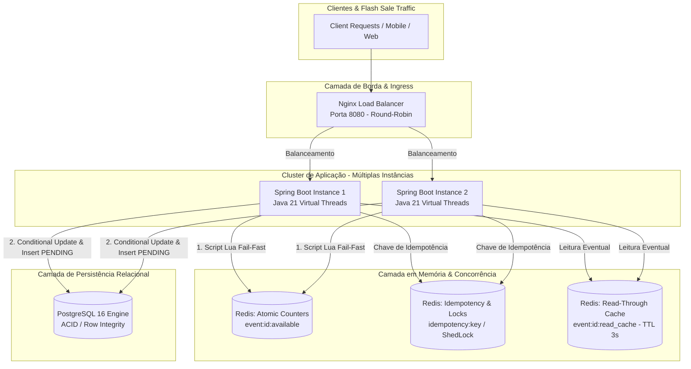

# Cielo Ticket Booking — Flash Sale Engine

Sistema distribuído de alta performance para reserva de ingressos em cenários de **Flash Sale com capacidade limitada**, projetado com foco estrito em **prevenção contra oversell (zero overselling)**, **idempotência de requisições**, **escalabilidade horizontal multi-instância** e **baixa latência sob alta concorrência**.

---

## 📑 Sumário

- [Visão Geral da Arquitetura](#-visão-geral-da-arquitetura)
- [Estratégia Anti-Oversell (Dual-Layer Defense)](#-estratégia-anti-oversell-dual-layer-defense)
- [Estrutura do Projeto e Camadas da Aplicação](#-estrutura-do-projeto-e-camadas-da-aplicação)
- [Stack Tecnológica](#-stack-tecnológica)
- [Como Executar o Projeto Localmente](#-como-executar-o-projeto-localmente)
- [Coleção de Testes e Endpoints da API](#-coleção-de-testes-e-endpoints-da-api)
- [Decisões Arquiteturais e Trade-offs](#-decisões-arquiteturais-e-trade-offs)
- [Documentação Técnica Aprofundada](#-documentação-técnica-aprofundada)

---

## 📐 Visão Geral da Arquitetura

O sistema opera de ponta a ponta em containers gerenciados pelo Docker Compose, distribuindo o tráfego via balanceamento de carga entre nós sem estado (*stateless*):



---

## 🛡️ Estratégia Anti-Oversell (Dual-Layer Defense)

Em uma flash sale com milhares de requisições por segundo disputando cotas reduzidas, utilizar transações pesadas ou travas pessimistas (`SELECT FOR UPDATE`) no PostgreSQL causa esgotamento da pool de conexões (HikariCP starvation) e deadlocks. O sistema adota a estratégia **Dual-Layer Defense**:

### 1. Camada 1 — Fail-Fast Atômico no Redis (Memória)
* As requisições executam o script Lua atômico `reserve_tickets.lua`.
* Por rodar em thread única no Redis, o script valida e decrementa o saldo instantaneamente em memória RAM.
* **Se o saldo esgotar:** Rejeita a requisição em microssegundos com `409 Conflict (Sold Out)`, sem sequer abrir transação no banco relacional.
* **Warm-up Lazy (Recuperação de Cache):** Caso a chave do evento não exista no Redis (retorno `-1`), a aplicação busca a capacidade no PostgreSQL, aquece o Redis via `SETNX` e reexecuta o script atômico.

### 2. Camada 2 — Consistência Transacional no PostgreSQL (Disco)
* Apenas requisições aprovadas pelo Redis chegam ao banco relacional.
* A persistência utiliza um **Update Condicional Atômico**:
  * Comando SQL: `UPDATE events SET available_capacity = available_capacity - :qty WHERE id = :id AND available_capacity >= :qty;`
* O motor do PostgreSQL garante a integridade em nível de linha (*row-level*). Se por inconsistência de dados nenhuma linha for alterada (`rowsUpdated == 0`), a aplicação aciona uma rotina de compensação imediata via `release_tickets.lua` no Redis, garantindo zero desvio de saldo.

---

## 🏛️ Estrutura do Projeto e Camadas da Aplicação

O projeto adota uma arquitetura em camadas inspirada nos princípios da **Arquitetura Limpa (Clean Architecture)** e **Domain-Driven Design (DDD)**, isolando regras de negócio de detalhes de framework:

```text
src/main/java/com/cielo/ticketbooking/
├── application/
│   ├── dto/                <-- Objetos de Transferência de Dados (Records)
│   └── service/            <-- Casos de uso e orquestração de negócios
├── domain/
│   ├── exception/          <-- Exceções de domínio mapeadas para RFC 7807
│   ├── model/              <-- Entidades e Enums do Domínio (JPA)
│   └── repository/         <-- Contratos de acesso a dados (Spring Data)
├── infrastructure/
│   ├── config/             <-- Configurações de Redis, ShedLock, Async
│   └── web/                <-- Controllers REST e Handler Global de Exceções
└── TicketBookingApplication.java
```

### O que cada camada faz:

* **application/dto/ (DTOs - Data Transfer Objects):**
  * **O que são:** Estruturas imutáveis (usando Java `record`) responsáveis pelo transporte de dados entre a borda HTTP e os serviços.
  * **Exemplos:** `ReserveTicketsRequest` (validação de entrada via Bean Validation) e `ReservationResponse` (serialização de retorno sem expor entidades de banco).
* **application/service/ (Camada de Aplicação / Serviços):**
  * **O que faz:** Orquestra os fluxos de caso de uso. Não contém regras SQL diretas.
  * **Responsabilidades:** Orquestra o script Lua do Redis, gerencia a transação relacional (`@Transactional`), trata chaves de idempotência e compensação de estoque.
* **domain/model/ (Camada de Domínio / Entidades):**
  * **O que faz:** Representa o coração das regras de negócio e integridade estrutural.
  * **Componentes:** Entidades `Event` e `Reservation`, enum `ReservationStatus` (`PENDING`, `CONFIRMED`, `CANCELLED`, `EXPIRED`).
* **domain/repository/ (Repositórios):**
  * **O que faz:** Interfaces de abstração de dados (Spring Data JPA) que contêm queries otimizadas e atômicas (`@Modifying`).
* **infrastructure/web/ (Camada de Entrada / Apresentação):**
  * **O que faz:** Controllers REST que expõem os endpoints da API, realizam validação de payloads (`@Valid`) e contam com `GlobalExceptionHandler` formatando erros corporativos no padrão **RFC 7807 (Problem Details)**.
* **infrastructure/config/ (Configurações de Infraestrutura):**
  * **O que faz:** Beans de inicialização do Redis (`StringRedisTemplate`), compilação dos scripts Lua com `DefaultRedisScript`, e configuração do **ShedLock** para tarefas agendadas em nós distribuídos.

---

## 🛠️ Stack Tecnológica

* **Linguagem:** Java 21 LTS (com suporte a Virtual Threads habilitado)
* **Framework:** Spring Boot 3.3.x (Spring Web, Spring Data JPA, Spring Data Redis)
* **Banco de Dados Relacional:** PostgreSQL 16 (Engine ACID com isolamento de transação)
* **Cache & In-Memory Store:** Redis 7 (Scripts Lua atômicos e lock distribuído)
* **Migrações de Banco:** Flyway Core (Controle e versionamento de schema SQL)
* **Scheduler Distribuído:** ShedLock 5.x (com provider Redis)
* **Borda & Balanceamento:** Nginx Alpine (Load Balancing L7 via Round-Robin)
* **Padronização de Erros:** RFC 7807 Problem Details
* **Containerização:** Docker & Docker Compose

---

## 🚀 Como Executar o Projeto Localmente

### Inicialização:

1. Suba todo o ambiente de infraestrutura e aplicação com um único comando:
   ```bash
   docker compose up --build -d
   ```

2. Verifique o status dos containers:
   ```bash
   docker compose ps
   ```

3. Acompanhe os logs em tempo real:
   ```bash
   docker compose logs -f app-1 app-2
   ```

---

## 🧪 Como Executar os Testes Unitários

Os testes utilizam JUnit 5, Mockito e Spring MockMvc. Execute-os pela raiz do projeto usando o Maven Wrapper:

**Windows (PowerShell):**
```powershell
.\mvnw.cmd test
```

**Linux/macOS:**
```bash
./mvnw test
```

Para executar apenas os testes de uma classe específica:

**Windows (PowerShell):**
```powershell
.\mvnw.cmd test "-Dtest=EventServiceTest"
```

**Linux/macOS:**
```bash
./mvnw test -Dtest=EventServiceTest
```

Substitua `EventServiceTest` pelo nome da classe desejada, por exemplo `ReservationServiceTest`, `EventControllerTest`, `ReservationControllerTest` ou `GlobalExceptionHandlerTest`.

---

## ⚡ Teste de Integração de Concorrência

O teste `ReservationConcurrencyIT` inicia a aplicação Spring Boot em uma porta aleatória e usa PostgreSQL e Redis reais nos containers locais. Não é necessário iniciar os containers da aplicação (`app-1`, `app-2` ou `nginx`), pois o próprio teste inicia uma instância isolada da aplicação para receber as requisições.

### Pré-requisitos e preparação

1. Inicie o Docker Desktop (ou outro daemon Docker) e confirme que as portas `5432` e `6379` estão disponíveis.
2. Na raiz do projeto, inicie somente o banco e o Redis:

```bash
docker compose up -d postgres redis
```

3. Confirme que ambos os serviços estão ativos:

```bash
docker compose ps postgres redis
```

O teste usa as configurações locais padrão da aplicação: PostgreSQL em `localhost:5432` e Redis em `localhost:6379`.

### Executar

Para executar todos os testes unitários e de integração:

**Windows (PowerShell):**
```powershell
.\mvnw.cmd verify
```

**Linux/macOS:**
```bash
./mvnw verify
```

Para executar somente o teste de concorrência:

**Windows (PowerShell):**
```powershell
.\mvnw.cmd verify "-Dit.test=ReservationConcurrencyIT"
```

**Linux/macOS:**
```bash
./mvnw verify -Dit.test=ReservationConcurrencyIT
```

### Como o teste funciona

1. Cria, pela API HTTP, um evento com capacidade inicial de 5 ingressos.
2. Prepara 50 tarefas em uma thread pool. Cada tarefa aguarda uma barreira (`CountDownLatch`); só depois que todas estão prontas, a barreira é liberada para iniciar a disputa simultaneamente.
3. Cada tarefa envia uma requisição `POST /events/{id}/reservations`, com quantidade 1 e uma chave de idempotência própria. Assim, conflitos de idempotência não são confundidos com falta de estoque.
4. Verifica as respostas: exatamente 5 devem retornar `201 Created`, 45 devem retornar `409 Conflict` com erro de estoque esgotado, e nenhum outro status é aceito.
5. Consulta o estado persistido e confirma que há exatamente 5 reservas, que a capacidade disponível no PostgreSQL é 0 e que a chave de estoque no Redis também vale 0. Essas verificações detectam venda acima do estoque ou capacidade negativa.

O teste cria dados no banco local e não os remove ao final. Cada execução cria um novo evento; mantenha os containers ativos durante toda a execução.

Ao finalizar a fase de integração, o Maven gera automaticamente um relatório executivo HTML consolidando os testes unitários, de controller e de concorrência:

```text
target/reports/test-report.html
```

Abra esse arquivo em um navegador para consultar o status geral, totais, duração, resultados por teste e as respostas HTTP individuais da disputa concorrente. O relatório é gerado na fase `post-integration-test`; assim, também fica disponível quando a integração termina com falhas e o Failsafe encerra o `verify` como build falha.

### Consultar a evidência das requisições

Durante a execução, o teste registra uma linha para cada cliente, com o identificador da execução, o cliente e o status HTTP recebido. Ao final, registra o total de requisições, sucessos, conflitos, reservas e estoques no PostgreSQL e no Redis.

Os logs aparecem no console ao executar o Maven. O Failsafe também salva os relatórios em `target/failsafe-reports/`; consulte `com.cielo.ticketbooking.integration.ReservationConcurrencyIT.txt` para o resultado resumido ou `TEST-com.cielo.ticketbooking.integration.ReservationConcurrencyIT.xml` para detalhes da execução e saída registrada.

No PowerShell, para filtrar as linhas de evidência diretamente no console:

```powershell
.\mvnw.cmd verify "-Dit.test=ReservationConcurrencyIT" | Select-String "Concurrency run="
```

---

## 📬 Coleção de Testes e Endpoints da API

O projeto inclui o arquivo **`ticket-booking-collection.json`** na raiz para importação imediata no **Postman** ou **Insomnia**.

| Método | Endpoint | Descrição | Status de Sucesso |
| :--- | :--- | :--- | :--- |
| `POST` | `/events` | Criação de evento com capacidade total de ingressos | `201 Created` |
| `GET` | `/events/:id` | Consulta capacidade e ingressos disponíveis (Cache de 3s) | `200 OK` |
| `POST` | `/events/:id/reservations` | Cria reserva com header `Idempotency-Key` e trava temporária | `201 Created` |
| `GET` | `/reservations/:id` | Consulta o status detalhado de uma reserva | `200 OK` |
| `DELETE` | `/reservations/:id` | Cancela uma reserva e estorna imediatamente a cota ao estoque | `204 No Content` |

---

## ⚖️ Decisões Arquiteturais e Trade-offs

* **Virtual Threads (Project Loom):** Habilitadas com `spring.threads.virtual.enabled=true`. Em vez de usar thread pools restritas pelo kernel do SO, a JVM utiliza threads leves de I/O não bloqueante, multiplicando a vazão por container em chamadas de banco e rede.
* **Idempotência em Duas Etapas:** Implementada via `SETNX` no Redis com TTL de 15 minutos associado ao header HTTP `Idempotency-Key`. Garante que retentativas de rede de clientes mobile não gerem duplicação de reservas nem debitem estoque extra.
* **ShedLock para Expiração de Reservas Pendentes:** Reservas têm validade de 10 minutos. Um job `@Scheduled` roda a cada 30 segundos limpando registros vencidos e devolvendo as cotas ao Redis e Postgres. O ShedLock garante que **apenas 1 das instâncias execute o job a cada ciclo**, eliminando concorrência entre containers.
* **Consistência Eventual na Consulta (`GET /events/:id`):** O volume de leituras em flash sales é centenas de vezes maior que o de compras. A consulta utiliza cache ultracurto no Redis (TTL de 3 segundos), absorvendo picos sem penalizar o banco relacional.

---

## 📚 Documentação Técnica Aprofundada

Para análises detalhadas com diagramas dedicados de cada subdomínio, consulte os arquivos na pasta `docs/architecture/`:

* [01. Topologia de Infraestrutura e Alta Disponibilidade](docs/architecture/01-topology.md)
* [02. Fluxo Crítico de Reserva e Barreira Anti-Oversell](docs/architecture/02-reservation-flow.md)
* [03. Ciclo de Vida da Reserva e Expiração Distribuída](docs/architecture/03-state-lifecycle.md)