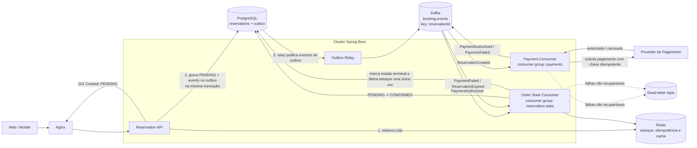

# 4. Evolução Proposta: Processamento Assíncrono com Kafka

Este documento descreve uma evolução futura da arquitetura. **Kafka e os consumidores abaixo não estão implementados neste projeto.** A proposta mantém o caminho crítico de reserva síncrono e usa eventos para desacoplar pagamento e atualização do estado do pedido.

## Decisão principal

| Componente | Responsabilidade proposta |
| :--- | :--- |
| Redis | Contador atômico de estoque, cache de leitura e controle de idempotência da API |
| PostgreSQL | Fonte de verdade para evento, reserva e outbox transacional |
| Kafka | Transporte durável de eventos entre reserva, pagamento e processamento do pedido |

O endpoint continua reservando a cota e persistindo a reserva como `PENDING`. A resposta `201 Created` significa que a reserva foi aceita e criada, **não que o pagamento foi aprovado**. O pagamento e a confirmação ocorrem depois, de forma assíncrona.

## Topologia proposta

## Um tópico e dois consumidores

É possível publicar os eventos em um único tópico, por exemplo `booking.events`, e ter dois grupos independentes:

- `payments`: processa `ReservationCreated`, chama o provedor de pagamento e publica o resultado.
- `reservation-state`: processa os eventos de pagamento e expiração relevantes e atualiza o estado da reserva.

Cada **consumer group** recebe uma cópia lógica de todos os eventos do tópico. Assim, os dois grupos podem reagir ao mesmo evento sem competir entre si. Dentro de um mesmo grupo, várias instâncias dividem as partições para escalar o processamento.

Para preservar a ordem de eventos da mesma reserva, usar `reservationId` como chave da mensagem. Um tópico único é simples para demonstrar o case; com o crescimento do domínio, tópicos separados (`reservations.events` e `payments.events`) podem melhorar isolamento, permissões e operação. A escolha deve ser validada com volume, retenção e ownership dos eventos.

## Fluxo e estados

1. A API valida idempotência, reserva estoque no Redis e persiste `Reservation(PENDING)` e `ReservationCreated` na tabela outbox dentro da mesma transação PostgreSQL.
2. O relay publica os registros do outbox no Kafka e os marca como publicados. Um crash pode levar à publicação duplicada; consumidores devem ser idempotentes.
3. O grupo `payments` processa `ReservationCreated`. A chamada ao provedor deve usar `reservationId` como chave idempotente, para que reentregas não cobrem duas vezes.
4. Após autorização, o consumer publica `PaymentAuthorized`. O consumer de estado faz uma transição condicional `PENDING -> CONFIRMED`.
5. Se o pagamento for recusado ou a reserva expirar, o estado passa a um resultado terminal definido pelo negócio e o estoque é devolvido uma única vez.
6. Eventos duplicados, atrasados ou fora de ordem não podem repetir cobrança, confirmação ou devolução de estoque.

O enum atual contém `PENDING`, `CONFIRMED`, `CANCELLED` e `EXPIRED`. Para distinguir claramente falha de pagamento de cancelamento solicitado pelo cliente, considerar adicionar `PAYMENT_FAILED` ou modelar o estado de pagamento separadamente. Essa decisão depende dos requisitos de consulta, suporte e reconciliação.

## Garantias necessárias

- **Transactional outbox:** evita persistir uma reserva sem registrar o evento correspondente, ou publicar evento de uma transação que depois sofreu rollback. O relay é normalmente *at-least-once*, não exatamente uma vez.
- **Inbox/deduplicação no consumidor:** persistir o `eventId` processado na mesma transação que a mudança de estado; uma restrição única impede efeitos duplicados.
- **Transições condicionais:** alterar status e registrar a devolução somente se a reserva ainda estiver no estado esperado, por exemplo `UPDATE ... WHERE status = 'PENDING'`.
- **Pagamento idempotente:** usar uma chave estável no provedor de pagamento e persistir a referência da transação. Não incluir dados de cartão nos eventos.
- **Retries e DLQ:** retries com backoff para falhas transitórias, dead-letter topic para mensagens que excedem a política e procedimento de replay acompanhado.
- **Expiração e corrida com pagamento:** definir o que fazer se a autorização chegar depois de `EXPIRED`/`CANCELLED` — tipicamente solicitar void/estorno e não confirmar a reserva.
- **Observabilidade:** propagar `eventId`, `reservationId` e `correlationId`; monitorar lag, retries, DLQ, idade do outbox e tempo até confirmação.

## Próximos passos sugeridos

1. Definir o contrato de eventos versionado (`ReservationCreated`, `PaymentAuthorized`, `PaymentFailed` e, se necessário, `ReservationExpired`).
2. Definir a política de negócio para falha/timeout do pagamento, expiração e autorização tardia.
3. Implementar tabela outbox e publicação confiável
4. Implementar consumidores idempotentes e transições condicionais de estado/estoque.
5. Adicionar Kafka local ao Compose e testes de integração: duplicação, reentrega, ordem por reserva, retry, DLQ e recuperação após reinício.
6. Medir latência e throughput e documentar como operar/reprocessar mensagens.